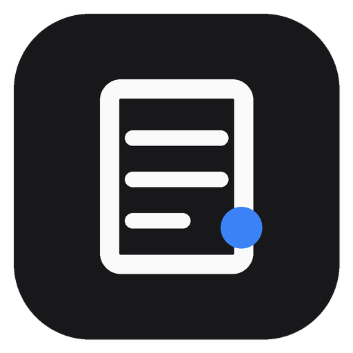
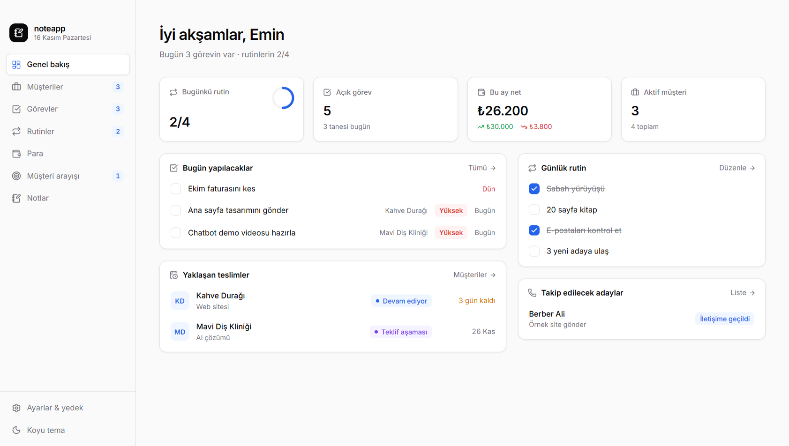
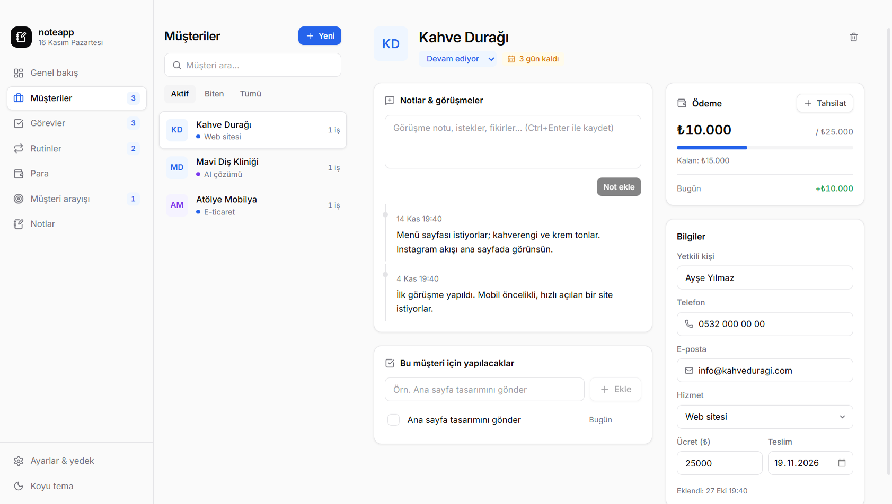
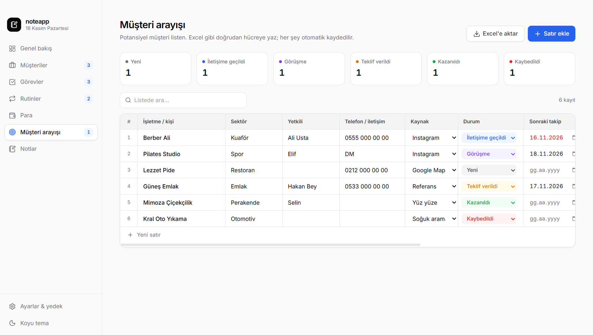
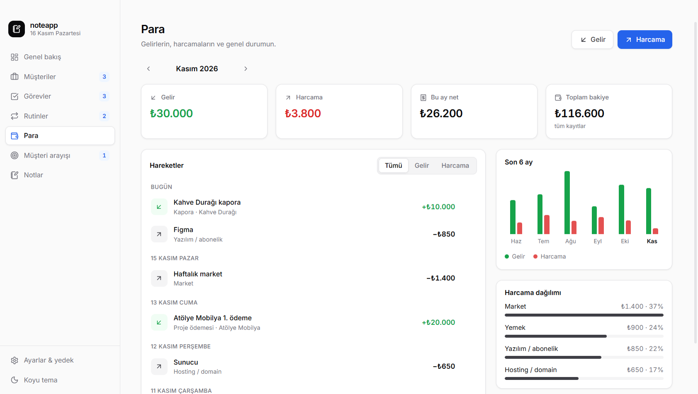
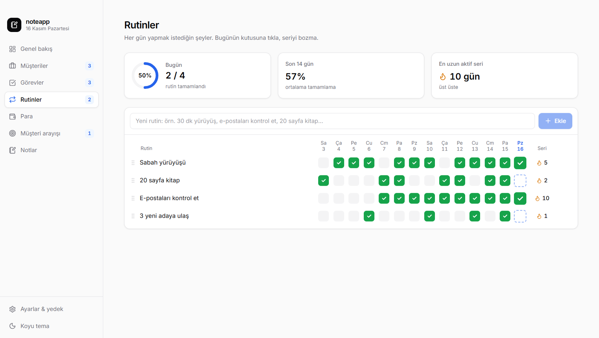
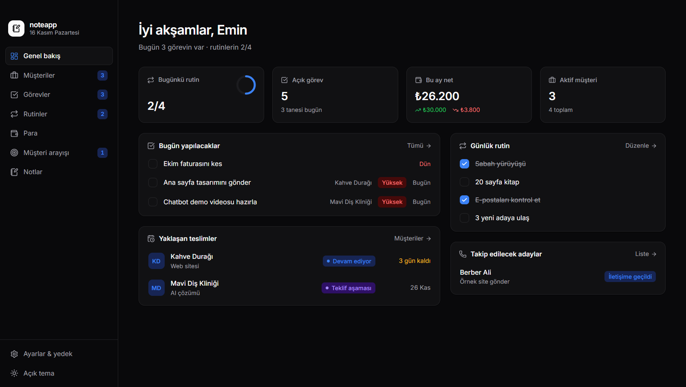

<div align="center">



# NoteApp

**Serbest çalışanlar için sade, hızlı ve tamamen çevrimdışı bir iş & hayat takip uygulaması.**

Müşteriler, görevler, günlük rutinler, para durumu, müşteri arayışı ve notlar tek bir Windows uygulamasında.




</div>

---

## Neden?

Web sitesi, uygulama ve yapay zekâ çözümleri satan biri olarak işlerim beş farklı yere dağılmıştı: müşteri notları bir yerde, yapılacaklar başka yerde, harcamalar Excel'de, potansiyel müşteriler telefonda. **NoteApp** hepsini tek, düzenli ve hızlı bir masaüstü uygulamasında topluyor.

- **Hesap yok, bulut yok, abonelik yok.** Veriler yalnızca bilgisayarında durur.
- **Sade ama düzenli.** Gereksiz menü veya ayar yok; her bölüm tek bir işi iyi yapar.
- **Akıcı.** Mikro animasyonlar uygulamayı canlı hissettirir ama dikkatini dağıtmaz.

## Özellikler

| Bölüm | Ne işe yarar |
|---|---|
| 🏠 **Genel bakış** | Bugünkü görevler, rutin ilerlemesi, bu ayın net kazancı, yaklaşan teslimler ve bugün aranacak adaylar tek ekranda. |
| 💼 **Müşteriler** | Her müşteri için tarihli görüşme notları, müşteriye özel yapılacaklar, anlaşılan ücret / tahsil edilen tutar, teslim tarihi ve iletişim bilgileri. |
| ✅ **Görevler** | Öncelik, tarih ve müşteri bağlantılı yapılacaklar. *Bugün · Yaklaşan · Tarihsiz · Tamamlanan* sekmeleri. |
| 🔁 **Rutinler** | 14 günlük alışkanlık tablosu, seri (streak) sayacı ve tamamlama oranı. |
| 💰 **Para** | Gelir / harcama kaydı, aylık özet, son 6 ay grafiği ve kategori dağılımı. Müşteri tahsilatları otomatik olarak gelire işlenir. |
| 🎯 **Müşteri arayışı** | Excel gibi doğrudan hücreye yazılan aday tablosu: durum hunisi, takip tarihleri, sıralama, arama, **Excel'e (CSV) aktarma** ve tek tıkla **müşteriye çevirme**. |
| 📝 **Notlar** | Sabitlenebilir, aranabilir serbest notlar. |
| ⚙️ **Ayarlar** | Açık / koyu tema, yedeği dışa aktarma ve geri yükleme. |

## Ekran görüntüleri

<table>
  <tr>
    <td><p align="center"><b>Müşteriler</b> — notlar, işler ve ödemeler</p></td>
    <td><p align="center"><b>Müşteri arayışı</b> — Excel gibi aday tablosu</p></td>
  </tr>
  <tr>
    <td><p align="center"><b>Para</b> — gelir, gider ve grafikler</p></td>
    <td><p align="center"><b>Rutinler</b> — günlük alışkanlık takibi</p></td>
  </tr>
  <tr>
    <td colspan="2"><p align="center"><b>Koyu tema</b></p></td>
  </tr>
</table>

## Kurulum

### Hazır kurulum dosyasıyla

1. Kaynak koddan `npm run dist` çalıştır; `release/NoteApp-Setup-x.x.x.exe` oluşur.
2. Çalıştır, kurulum klasörünü seç. Masaüstüne ve Başlat menüsüne kısayol eklenir.

> İmzasız bir uygulama olduğu için Windows SmartScreen uyarı verebilir: **Ek bilgi → Yine de çalıştır**.

### Kaynak koddan

Gereksinim: [Node.js](https://nodejs.org) 20+

```bash
git clone https://github.com/EminBayindiRli/noteapp.git
cd noteapp
npm install
npm run dev        # geliştirme modu (canlı yenileme)
```

| Komut | Açıklama |
|---|---|
| `npm run dev` | Vite + Electron'u geliştirme modunda başlatır |
| `npm start` | Derleyip uygulamayı üretim modunda açar |
| `npm run dist` | Windows kurulum dosyasını `release/` klasörüne üretir |
| `npm run screenshots` | README ekran görüntülerini demo verisiyle yeniden üretir |

## Klavye kısayolları

| Kısayol | İşlev |
|---|---|
| `Ctrl` + `1` … `7` | Bölümler arasında geçiş |
| `Ctrl` + `8` | Ayarlar |
| `Ctrl` + `N` | Yeni not (Notlar bölümünde) |
| `Ctrl` + `Enter` | Müşteri notunu kaydet |
| `Esc` | Açık pencereyi kapat |

## Verilerin nerede?

Her değişiklik anında otomatik kaydedilir:

```
%APPDATA%\NoteApp\noteapp-data.json      ← tüm verin
%APPDATA%\NoteApp\backups\               ← günlük otomatik yedekler (son 30 gün)
```

- Kayıt **atomik** yapılır (önce geçici dosyaya yazılır, sonra yer değiştirilir), böylece elektrik kesintisinde dosya bozulmaz.
- **Ayarlar → Yedeği dışa aktar** ile tek bir JSON dosyası alıp başka bir bilgisayara taşıyabilirsin.
- Bu depo yalnızca **kodu** içerir; kişisel verilerin asla GitHub'a gönderilmez.

## Teknik yapı

```
noteapp/
├─ electron/
│  ├─ main.cjs         # pencere, dosyaya kayıt, yedekleme, IPC
│  └─ preload.cjs      # arayüze güvenli API (contextIsolation)
├─ src/
│  ├─ App.jsx          # kenar çubuğu, sayfa geçişleri, tema
│  ├─ store.jsx        # merkezi veri deposu (React Context + gecikmeli kayıt)
│  ├─ components/ui.jsx# Button, Modal, Checkbox, Ring, Segmented… ortak bileşenler
│  ├─ pages/           # Dashboard, Clients, Tasks, Routines, Finance, Leads, Notes, Settings
│  ├─ constants.js     # durumlar, kategoriler, hizmet türleri
│  └─ utils.js         # tarih, para birimi (₺), CSV yardımcıları
├─ scripts/screenshots.cjs
└─ build/              # uygulama ikonu
```

- **Electron 45** — masaüstü kabuğu, Windows'a özel başlık çubuğu (title bar overlay)
- **React 19 + Vite 8** — hızlı arayüz ve derleme
- **Tailwind CSS 4** — CSS değişkenleriyle açık/koyu tema tasarım sistemi
- **Framer Motion** — sayfa geçişleri, paylaşımlı `layoutId` animasyonları, yay (spring) fizikli mikro etkileşimler
- **Lucide** ikonları ve **Inter** yazı tipi (uygulamaya gömülü, internet gerektirmez)
- Tasarım kararları **UI UX Pro Max** tasarım sistemi önerilerine göre alındı: monokrom zinc paleti + mavi vurgu, 150–300 ms etkileşim süreleri, görünür odak halkaları ve `prefers-reduced-motion` desteği.

## Yol haritası

- [ ] Müşteriler için dosya / bağlantı ekleme
- [ ] Tekrarlayan görevler (her hafta, her ay)
- [ ] Haftalık / aylık PDF raporu
- [ ] Aday tablosuna Excel'den içe aktarma
- [ ] Hatırlatıcı bildirimleri

---

<div align="center">
<sub>Kişisel kullanım için ❤️ ile yapıldı.</sub>
</div>
